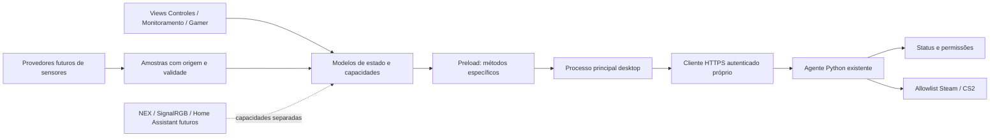

# Auditoria Windows e plano de migração

## Estrutura constatada

| Módulo | Situação no checkpoint d5323f7 | Reutilização |
| --- | --- | --- |
| `apps/windows-ui/package.json` e lockfile | Electron **45.0.0**, electron-builder **26.15.3**, produto `2.0.0-dev.2`; Node **22.16.x**, npm **10.9.x**, runtime Node local 22.16.0 | Preservar tecnologia, lockfile e identidade de distribuição |
| `main.cjs` | Janela 465×830, mínimo 350×530; sem moldura, transparente e redimensionável | Evoluir para duas composições da mesma aplicação após revisão |
| `preload.cjs` | Apenas `getVersion`, `minimize` e `close` em `loneDesktop` | Manter fronteira pequena; acrescentar métodos específicos somente na fase funcional |
| `index.html`, `styles.css`, `app.js` | Interface legada demonstrativa, ícone de casa, três abas, sensores/voz/dispositivos/cenas simulados e preferências `lone-smart-room-demo-v1` | Preservar cópia e preferências; reutilizar organização, sem transportar os números simulados para telemetria real |
| `agent-status.js`, `app-launch.js` | Usam a bridge `window.LoneAgent`, fornecida pelo Android, que o preload Electron atual **não expõe** | Reutilizar semântica de estados e testes; criar adaptador desktop explícito, não presumir conexão existente |
| `app-version.js` | Versão obtida da bridge correspondente | Reutilizar renderização dinâmica da versão; não usar versão Android para nomear a build Windows |
| `agent/windows/secure_*.py` | HTTPS, identidade TLS, HMAC, nonce/timestamp, pareamento, revogação e permissões por dispositivo/aplicativo | Reutilizar protocolo e executor sem substituí-los pelo renderer |
| `steam_launcher.py` e `cs2_launcher.py` | Steam executável validado, `Popen`, sem shell; CS2 argumentos fixos `-applaunch 730` | Preservar os executores e suas verificações; nenhuma abertura nesta etapa |
| `secure_agent.py` / `secure_startup.py` | Agente independente do Electron, inicialização por login e restrição à rede Privada autorizada | Dashboard/widget não devem iniciar cópias ou se tornar requisito do agente |

Os requisitos Python estão fixados em `cryptography==50.0.2`, `cffi==2.1.1`, `pycparser==3.12`. Não existe provedor de sensores nas dependências declaradas examinadas. Não foi instalada biblioteca para monitoramento.

O empacotamento existente produz NSIS e portable x64 e usa `assets/icon.ico`. `scripts/windows-build.ps1` executa `npm ci`, prepara ferramentas de empacotamento e chama `dist:win`; portanto **não foi executado** nesta tarefa de design. Há artefatos 1.4.0 e dev.2 em `apps/windows-ui/dist/`, preservados. Não se verificou qual versão Windows está instalada no sistema, a assinatura Authenticode dos instaladores ou uma nova compilação reproduzível.

Os documentos antigos `LEIA-ME.md` e `ARCHITECTURE.md` incluem etapas históricas anteriores à comunicação autenticada; não devem ser tratados como descrição atual do Android validado. Os relatórios da fase 2, Steam/CS2 e Samsung dev.7 têm precedência factual.

## Lacunas antes da migração funcional

1. **Não existe cliente desktop seguro.** Não basta copiar os scripts Android para o Electron ou trocar o HTML. A bridge de status/apps atual não funciona no desktop sem implementação específica.
2. **CSP e navegação:** o HTML funcional antigo não declara CSP; a restrição de navegação aceita qualquer URL que comece por `file://`. Ao expandir IPC, será necessário validar documento/origem e frame exatos, limitar permissões e bloquear navegações externas. O processo principal já usa isolamento de contexto, sandbox e Node desativado no renderer. DevTools está habilitado e precisará de configuração para distribuição. São constatações, sem correção nesta entrega.
3. **Dados demonstrativos:** métricas, processos fictícios, ações de voz e estado “PC desligado” do widget pertencem à simulação legada. O dashboard real deverá consumir estados explícitos e mostrar indisponibilidade até existir fonte válida; nunca converter ausência de resposta em confirmação de desligamento.
4. **Identidade e armazenamento:** preservar `name: lone-smart-room`, `appId: com.lone.smartroom`, perfil Electron e dados locais existentes. Esse appId é diferente do package Android, o que não é motivo para trocá-lo. Antes de mudar origem/protocolo ou diretórios, mapear e salvar o `userData` efetivo. Não importar valores demo como configurações reais, nem apagar a chave antiga automaticamente.
5. **Dependências:** o audit histórico inicial tinha 14 achados; `docs/dependency-audit-stage2.json` registra zero após a preparação anterior. Nenhum `npm audit` novo foi executado, portanto não se afirma ausência atual de vulnerabilidades. Revisar a árvore instalada/lockfile e uma auditoria atual antes da distribuição, sem atualizações automáticas de major nesta fase.
6. **TLS conhecido:** resets ao rejeitar corpos excessivos continuam separados desta migração. Não foi aplicada correção ao agente ou tolerância indiscriminada a certificados.

As medidas de CSP, isolamento e validação do remetente IPC seguem a [orientação oficial de segurança Electron](https://www.electronjs.org/docs/latest/tutorial/security/). Métodos individuais por capacidade evitam expor `ipcRenderer` completo ao renderer, conforme [contextBridge](https://www.electronjs.org/docs/latest/api/context-bridge). Essas são propostas para a fase funcional, não garantias sobre uma integração ainda inexistente.

## Arquitetura proposta



**Apresentação:** componentes de marca, navegação, cartão do PC, sensores, permissões e painéis. Dashboard e widget usam o mesmo estado; fechar ou trocar a composição não modifica o agente. Preferências apenas visuais ficam separadas de credenciais.

**Adaptadores de capacidade:** `StatusClient`, `PermissionsClient`, `AppCommandClient` e futuramente `TelemetryProvider`, com respostas tipadas e estados indisponível/obsoleto/erro. Sem uma capacidade disponível, os controles permanecem bloqueados. Sem API genérica de shell, executável, argumentos, URL arbitrária ou operação de arquivo enviada pelo renderer.

**Cliente desktop:** identidade própria, sem copiar as credenciais do Samsung. Na primeira integração, somente pareamento explicitamente iniciado pelo usuário, consulta de `/v2/status` e leitura de `/v2/apps`. Preservar validação de TLS/host/pin, HMAC e replay; validar corpo e origem de cada pedido. Não conceder grants ao criar a identidade e não implementar abertura nessa primeira conexão.

**Segredos:** permanecem no processo principal/serviço local protegido. Avaliar `safeStorage` assíncrono do Electron 45, sem fallback em texto claro; ele usa DPAPI no Windows, mas não isola segredos de outros programas do mesmo usuário. [Documentação oficial](https://www.electronjs.org/docs/latest/api/safe-storage). Não persistir segredo no DOM, localStorage, logs ou pacote. O cofre DPAPI do agente e o AndroidKeystore existente não serão reutilizados por cópia para o desktop.

**Gestão local de grants:** hoje é feita por comandos administrativos locais de lista fixa do agente, não por endpoint HTTPS de concessão. Um painel administrativo futuro exigirá um broker local restrito ao usuário, operações enumeradas e confirmação específica de dispositivo + aplicativo. Não expor uma ponte de terminal nem executar comandos montados a partir da UI. A implementação e revisão desse broker constituem etapa separada; não é parte da prévia.

**Executores:** somente após aprovação e testes de negação, encaminhar IDs fixos `steam` e `cs2` ao mecanismo existente. O agente continua validando a permissão do dispositivo e executando sem elevação. Não duplicar `Popen` ou abrir URI no renderer/preload. “Executado” continua significando despacho, com confirmação de janela/menu separada no teste físico.

## Sensores: avaliação, sem instalação

| Dados | Proposta inicial | Limite a validar |
| --- | --- | --- |
| CPU e RAM | Provedor local somente leitura via APIs Windows; avaliar `GetSystemTimes`, `GlobalMemoryStatusEx` ou PDH | CPU exige diferença entre amostras; definir CPU total/por núcleo e RAM física com unidade consistente |
| GPU e memória gráfica | Provedor Windows por adaptador/engine e capacidades do driver | Não somar percentuais de engines cegamente; validar múltiplas GPUs e suporte WDDM |
| Temperaturas | Provedor separado, opt-in e sujeito a avaliação de privilégios/compatibilidade | Ausência/erro sempre `null` e qualidade explícita; não usar 0 °C como substituto |

As APIs e contadores Windows oferecem dados de CPU/memória; a Microsoft recomenda considerar APIs diretas e informa limites de frequência para Performance Counters. Proponho começar com uma amostra por segundo, reduzindo ou pausando ao ocultar o dashboard. [Performance Counters](https://learn.microsoft.com/en-us/windows/win32/perfctrs/about-performance-counters), [GlobalMemoryStatusEx](https://learn.microsoft.com/en-us/windows/win32/api/sysinfoapi/nf-sysinfoapi-globalmemorystatusex).

O subsistema gráfico distingue engines e usa suporte WDDM; será preciso validar a agregação do indicador da GPU neste computador antes de exibi-lo como leitura real. [Microsoft DirectX: GPUs no Task Manager](https://devblogs.microsoft.com/directx/gpus-in-the-task-manager/). Nenhum diagnóstico ou alteração de driver foi executado nesta entrega.

LibreHardwareMonitor é uma opção a estudar para temperaturas, não uma dependência escolhida. O próprio projeto informa que alguns sensores exigem privilégios de administrador e lista sua licença MPL 2.0 e componentes com outras licenças. Qualquer biblioteca/helper/driver adicional precisará de avaliação e autorização próprias; não elevar o dashboard ou inserir coleta/injeção no jogo. [Repositório oficial](https://github.com/LibreHardwareMonitor/LibreHardwareMonitor). Nenhuma compatibilidade com este hardware ou com VAC foi comprovada nesta fase.

Contrato de amostra proposto, ainda não implementado:

```json
{
  "metric": "gpu.temperature",
  "value": null,
  "unit": "celsius",
  "source": null,
  "sampledAt": null,
  "quality": "unavailable"
}
```

O coletor futuro deve ter timeout, falha isolada, limites de frequência e descarte de dados antigos. O gráfico só recebe pontos com leitura válida. RPM, otimização, SignalRGB, Home Assistant e NEX ficam fora dessa integração inicial; cada futuro adaptador deve declarar capacidades e consentimentos sem obter permissão implícita sobre executores.

## Plano e critérios de aceitação

| Fase | Trabalho proposto | Critério antes de avançar |
| --- | --- | --- |
| 1 — esta entrega | Auditoria, prévia, capturas e preservação | Aprovação visual; 131 assertivas/24 cenários aprovados; fontes existentes intactas |
| 2 — migração visual | Incorporar views aprovadas ao Electron existente, ícone oficial e versão dinâmica; manter perfil/identidade | Dashboard/widget navegáveis; zero simulações confundidas com dados reais; nenhuma ação operacional habilitada; testes de armazenamento |
| 3 — status seguro | Cliente desktop próprio e IPC mínimo; somente status e permissões | TLS inválido, timeout, replay, dispositivo revogado e grants ausentes tratados corretamente; segredo fora do renderer; nenhum lançamento |
| 4 — ações existentes | Conectar allowlist aos executores já validados | Testes com substitutos; concessão só explícita; revogação imediata; confirmação nativa; teste físico único apenas com autorização |
| 5 — telemetria | Primeiro CPU/RAM; GPU/temperaturas por capacidade verificada | Comparar leituras reais e unidades; amostra antiga/ausente explícita; sem driver ou privilégio adicional automático |
| 6 — distribuição | Validar empacotamento NSIS/portable, assinatura Windows e atualização | Backups, identidade e perfil preservados; nova autorização antes de instalar/substituir |

Cada fase deve ter commit isolado e validação própria. Antes de migrar, preservar executáveis atuais e mapear o perfil desktop; reversão de código/build não deve apagar dados ou tocar em grants, certificados ou pareamento. Não executar instaladores durante a revisão.

## O que não foi comprovado

Não foram testados conexão real do Electron com o agente, autenticação de uma identidade desktop, novos sensores, bandeja/always-on-top, DPI real de múltiplos monitores, leitores de tela, teclado físico, instalador/assinatura Windows ou atualização de uma instalação existente. O Samsung dev.7 não foi acessado. As capturas cobrem os viewports CSS informados; não equivalem à validação física dessas condições no Windows.
