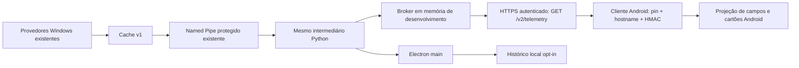

# Sessão autônoma de desenvolvimento — 27/10/2026

Branch isolada: `feature/telemetry-android-development`, baseada em `db635c1`.
Os checkpoints recentes pertencem a essa linha de histórico; o checkout paralelo
`LSR-hardware-readonly-c1` não foi alterado. Não houve merge, instalação ou
atualização operacional.

## Resultado

| Etapa | Implementação efetiva | Limite atual |
|---|---|---|
| Windows → Android | Contrato, cache limitado, servidor HTTPS de desenvolvimento, autorização de leitura, cliente Android, projeção Kotlin, cartões e polling por visibilidade | Sem ativação LAN/produção ou homologação Samsung |
| Histórico | Séries CPU/GPU/RAM/discos, janelas 5/30/60 min, retenção/espaço limitados, persistência própria e gráficos | Opt-in; contrato de histórico Android preparado, sem rota remota de histórico |
| Autodiagnóstico | Cinco adaptadores → cache → worker mock → main → preload → cartões existentes | Somente simulação; nenhum leitor operacional ativado |
| Gamer Launcher | Sessão v1, frametime/FPS/média/1% Low, arquivo lógico de até 20 resumos em memória, interface | Fonte real de FPS não implementada; sem captura, jogo ou overlay |

Detalhes: [telemetria](TELEMETRY.md), [histórico](HISTORY.md),
[diagnóstico](DIAGNOSTICS.md), [sessões de jogo](GAMER.md).

## Caminho dos dados e preservação

O GET novo exige autenticação **e allowlist explícita de leitura**; pareamento
sozinho não basta. Essa autorização é separada dos grants de Steam/CS2. O servidor
operacional original não foi modificado. A composição executável preparada usa
somente loopback e identidade DEV preexistente, independente da instalação real.
Não se afirma que métricas já chegam ao Samsung instalado.

Estão preparados CPU (%), GPU (%/°C/hotspot/MB/MHz/W/RPM), RAM e capacidade,
ocupação, I/O e atividade de C:/D:. Ausência de fonte/suporte permanece nula.
Temperatura de CPU e FPS real continuam indisponíveis. Nenhum sensor foi lido
fisicamente nesta sessão. A coleta continua vinculada ao ciclo de vida do
monitoramento Windows; sem seu coletor, a rota informa indisponibilidade. A
cadência de inatividade continua a existente, não uma coleta remota permanente.

O Android consulta apenas com a aba visível e atividade em primeiro plano,
com uma requisição pendente, timeout e backoff. Cada amostra antiga fica oculta
após retomada até um novo timestamp válido. O cache não renova a idade ao ser
lido. Nulo, zero válido e desatualizado são distintos. Fontes, unidades e relações
de capacidade/percentuais são validadas. VRAM mantém MB do SDK; RAM/discos em bytes.

## Testes executados

| Grupo | Resultado |
|---|---:|
| Telemetria Python/HTTPS isolado | 15 testes aprovados |
| Regressões Python com operações externas bloqueadas | 378 aprovados |
| Preservação Android adicional | 3 aprovados |
| Regressões Node existentes | 891 verificações contadas, 12 suítes |
| Contrato/UI remota Android | 24 verificações |
| Histórico/retenção/persistência/preload | 1.928 verificações, incluindo 1.900 inserções simuladas |
| Cinco adaptadores → Central | 70 verificações |
| Sessões de jogo | 127 verificações |
| Renderer Android responsivo | 352 verificações, 63 combinações |
| Prévias finais dos renderers | 12 verificações, 15 capturas |
| Android assemble/lint | Build aprovado, 0 erros/10 avisos preexistentes |
| Gradle unit tests | NO-SOURCE; não contado como testes aprovados |

O teste JVM usou **PinnedTls e AgentAuth de produção**, com certificado/dispositivo
sintéticos e porta efêmera em loopback: pin errado, hostname errado, replay,
assinatura de outra rota e POST/caminho arbitrário foram rejeitados. A resposta
também foi interpretada pelo modelo/UI JavaScript Android real. A projeção Kotlin
JSONObject foi compilada/lintada, sem execução de runtime Android nesta sessão.

Não houve instalação de dependências. O runner reproduzível é
`scripts/test-night-development.ps1`; `-BuildAndroid` acrescenta build/lint com SDK
existente. O roteiro de capturas é `scripts/capture-night-development.cjs` e nunca
carrega o main de produção ou sensores. Os corpos excessivos/ambíguos do problema
TLS 10054 não foram reproduzidos no agente real.

## Falhas encontradas e tratamento

- Sandbox bloqueou loopback (10013) e comunicação local do Gradle. Testes foram
  executados com permissão de ferramenta para esses ambientes isolados; nenhum
  firewall/proteção foi alterado.
- O teste JVM encontrou a allowlist de assinatura sem a rota nova. Foi acrescentado
  **somente GET /v2/telemetry**. HMAC/canonização/chaves/nonce e demais rotas foram
  preservados, e os testes agora cobrem esse caminho nativo.
- Testes visuais encontraram transbordamento de “Indisponível” e CSS inline
  incompatível com CSP. Corrigidos sem relaxar CSP. Barras são exclusivas de
  percentuais; temperatura não usa uma barra percentual sem escala.
- Uma chamada inicial ao teste de ícone não encontrou `sharp`; isso não foi
  contabilizado como aprovação. Não se instalou a dependência. Os assets aprovados
  permaneceram cobertos pelos testes de preservação e pela compilação.
- Primeiro roteiro de captura importou o pacote Electron incorretamente, deixando
  um processo de prévia (PID 11724). A tentativa normal `CloseMainWindow` retornou
  falso e Computer Use não encontrou janela desse processo. **Não houve kill**.
  Ele permanecia presente na última inspeção, sem coletor/IPC/ADLX. É uma pendência
  de limpeza autorizada para quando o usuário retornar, não um processo operacional.
  As execuções seguintes corrigidas terminaram normalmente. O watchdog foi
  antecipado para evitar recorrência desse erro de bootstrap no roteiro.
- O protocolo Chromium aguardou uma página ainda não inicializada no roteiro de
  captura. Corrigido inicializando uma página local vazia antes da instrumentação.
  Nenhuma falha foi ocultada por desativação de validações.

## Recursos medidos em mocks

Na última execução controlada: 600 registros históricos + 1.200 frames simulados,
mesmo processo Node, 70,95 ms de tempo decorrido, 62 ms de CPU em usuário + 31 ms
de sistema; RSS amostrado médio 37,44 MiB e pico 41,18 MiB (14 observações).
Inclui runtime e fixtures. Não é consumo do coletor, Electron instalado ou GPU;
não se compara com a meta de CPU total <0,5%. Valores completos em
[mock-resource-results.json](mock-resource-results.json).

## Evidências visuais

[Abrir revisão das telas](review.html). Todas as capturas são dos arquivos reais
de interface renderizados em Chromium isolado, com simulação identificada.
Não são capturas de Samsung, sensores físicos ou aplicativo instalado.

- Android: Controles, Monitoramento PC e Gamer Launcher em 390×844 e 360×800;
  detalhes GPU/RAM e armazenamento.
- Windows: Controles, Monitoramento, histórico, Central, Gamer Launcher,
  sessão indisponível e layout Widget. A bandeja instalada não foi testada.

## Integridade e estado operacional

15 arquivos selecionados foram comparados antes/depois e mantiveram os hashes:
executável e `app.asar` instalados, APK aprovado, manifesto do backup dev.7,
arquivos protegidos de configuração/certificados e fontes originais do agente.
O APK dev.9/v23 preserva SHA-256
`92713289374d0c7824ec573713f78e406e1f73b914714c10264d19dc06ac7df2`.

Isso **não** é uma auditoria integral de todos os arquivos das instalações,
perfil ou conteúdo dos backups. O manifesto do backup foi conferido, sem rehash
integral do seu conteúdo. O banco operacional não foi aberto. Não foram consultados
status, listener ou grants do agente nesta sessão; portanto não se declara nova
confirmação de agente online/zero grants. Nenhum grant foi criado por este trabalho.
Não houve ADB, instalação, comandos operacionais ou mudanças em HKCU Run, serviços,
firewall, energia, drivers ou credenciais. O perfil de produção não foi usado.

O `app-debug.apk` compilado é apenas artefato local de testes com a numeração
existente, não um novo APK aprovado para atualização. O APK assinado aprovado e
as instalações continuam separados desse produto de compilação.

## Checkpoints e reversão

- `72012be`: primeiro fluxo de telemetria de desenvolvimento.
- `ea7902d`: histórico limitado e gráficos opt-in.
- `068bb8b`: cinco adaptadores simulados integrados à Central.
- `d433b61`: apresentação do histórico sem placeholder duplicado.
- `303b155`: contratos e interface de sessão de jogo, sem captura.
- `4671ec1`: correção da rota HMAC e validações de métricas.
- `1ea85aa`: legibilidade/unidades dos gráficos.
- `311935e`: escopo explícito de leitura e isolamento da identidade DEV.
- `85109f7`: rejeição de FPS não verificado e datas inválidas.
- `74c7eb9`: ferramentas de regressão, medição de mocks e capturas.
- O checkpoint documental final registra este relatório e as evidências.

Reversão de código por `git revert` dos commits dessa branch, em ordem inversa,
sem reset/merge sobre a branch original. A fundação de telemetria é dependência
dos testes posteriores; não remover módulos isoladamente mantendo seus imports.
Não há instalação, migração de banco operacional ou Registro a desfazer. Qualquer
limpeza de dados temporários deve atingir somente `.cache` dos módulos novos,
nunca perfis ou backups existentes.

## Próxima homologação, somente com autorização própria

1. Revisar as prévias, os diffs e a política de leitura por dispositivo.
2. Resolver a pendência do processo de prévia sem encerramento forçado automático.
3. Preparar identidade/configuração LAN de desenvolvimento separada, transporte
   de fan-out, porta autorizada e build Android com nova numeração/assinatura
   compatível, sem substituir o agente ativo para esse teste.
   A identidade de teste deverá ficar em memória/perfil de teste próprio, sem
   sobrescrever o AgentVault ou refazer o pareamento operacional do Samsung.
4. Autorizar uma sessão limitada de dados reais e Android, com confirmação de
   frescor, retomada, desconexão, custo e encerramento dos componentes próprios.
5. Somente depois decidir a implantação operacional e eventuais pacotes Windows.

Permanecem abertas: TLS 10054, inicialização automática, encerramento gracioso,
Crashpad, homologação GPU após bandeja, splash nativa e temperatura do i5-12400.
Não foram corrigidas nem declaradas resolvidas por esta sessão.
