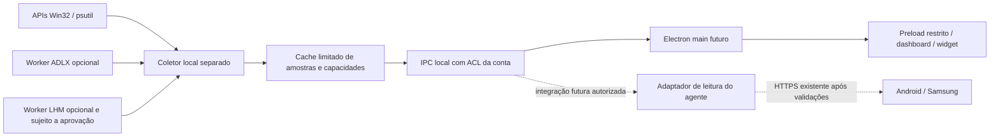

# Monitoramento real do PC — auditoria e proposta

Data de referência: 24/10/2026, America/Sao_Paulo. Pesquisa nas fontes oficiais,
leitura dos fontes locais e planejamento; **nenhum coletor implementado ou executado**.

Base: branch `feature/ui-migration-preview`, HEAD anterior
`fa2a3cffb1f6a34b9a2f47c659615fef4324d268`. Preservados os checkpoints
`0ddcd8c`, `2d345f8`, `808dffb`, `78101019515b6f056760ef90c789e9b412a38261`
e os demais avanços existentes.

## Conclusão e limite desta auditoria

Recomenda-se começar com um **coletor local independente, sem elevação**, para uso de
CPU, RAM e discos. A GPU Radeon deve ter um provedor opcional ADLX exclusivamente
de leitura. Temperatura da CPU e ventoinhas da placa-mãe ficam indisponíveis até
validar uma solução específica de acesso ao hardware e suas permissões.

Hardware informado pelo usuário, utilizado como requisito e não como inventário
medido: **Core i5-12400, RX 6750 XT 12 GB, 16 GB DDR4, Windows 11**. Não foram
consultados sensores, WMI/CIM, contadores PDH, GPU, SMART, processos ou porta 8776
nesta fase. Não foram instalados pacotes nem executados aplicativos do produto.

O agente legado não foi sinalizado, atualizado, iniciado ou encerrado. O último
estado conhecido é HTTPS ativo e Samsung **Conectado**, conforme o checkpoint e a
confirmação do usuário; não se apresenta isso como nova medição. A decisão de manter
essa sessão está registrada no [gate da sessão legada](../legacy-release-gate-2026-10-24/README.md).
Zero grants permanece a política preservada, sem nova consulta ao banco operacional.

## Estrutura atual que pode ser reaproveitada

| Área lida | Constatação e consequência |
|---|---|
| `agent/windows/requirements.txt` e `.lock` | cffi 2.1.1, cryptography 50.0.2 e pycparser 3.12; não há dependência de monitoramento declarada. Não modificar essa venv para experimentar sensores |
| `agent/windows/secure_http.py` | Status autenticado em `/v2/status`; permissões e resultado de comandos em rotas próprias. Não existe contrato de telemetria nessa implementação; status online não contém medições |
| `apps/windows-ui/package.json` | Electron 45.0.0, electron-builder 26.15.3, Windows dev.4. Manter dashboard, bandeja e widget existentes |
| `desktop.js` | CPU, GPU, RAM e temperatura mostram `—`, com coleta não implementada. Preservar essa honestidade até existir amostra real |
| `desktop-main.cjs`, `preload.cjs` | Isolamento de contexto, sandbox e API limitada a versão/janela; sem cliente autenticado operacional. Não introduzir leitura de sensores no renderer |
| `apps/android/app/build.gradle.kts` | `com.lonesmartroom.app`, dev.7, código 21. Nenhuma alteração Android ou de assinatura prevista nesta fase |
| Arquitetura desktop já documentada | Identidade própria e armazenamento seguro para um futuro cliente HTTPS; vedado copiar a identidade do Samsung |

Essas constatações são dos fontes, não uma nova inspeção das instalações físicas.
Não há motivo para substituir os executores Steam/CS2 ou a bridge WoL.

## APIs e bibliotecas recomendadas

| Métrica | Provedor preferido | Compatibilidade esperada e permissões | Limitação a apresentar |
|---|---|---|---|
| Utilização CPU | `GetSystemTimes`; opcionalmente `psutil.cpu_percent` | Independente do modelo de CPU, adequado ao i5-12400; normalmente usuário comum | Exige intervalo entre amostras; não mede temperatura |
| RAM utilizada/disponível | `GlobalMemoryStatusEx` / `psutil.virtual_memory` | Adequado aos 16 GB; sem driver adicional ou elevação na configuração comum | Total utilizável pode diferir da capacidade instalada; não confundir disponível com simplesmente livre |
| Espaço por volume | `GetDiskFreeSpaceExW` / `psutil.disk_usage` | Independente de SATA/NVMe; acesso ao diretório consultado | Quotas podem alterar espaço disponível à conta; não enumerar volumes de rede/removíveis por padrão |
| I/O e atividade dos discos | PDH `PhysicalDisk` / `LogicalDisk`; `psutil.disk_io_counters` para bytes e operações | Consulta local interativa normalmente permitida; disponibilidade depende de contadores e ACL | Bytes/s não são percentual de tempo ativo; não habilitar contadores nem mudar permissões automaticamente |
| Utilização GPU | ADLX Performance Monitoring; alternativa PDH `GPU Engine` | RX 6750 XT é candidata à integração AMD; suporte exato depende do driver/interfaces. Objetivo: leitura pelo usuário comum | Validar capacidades por adaptador e métrica; não somar GPUs diferentes |
| Temperatura GPU / hotspot | ADLX `GPUTemperature` / `GPUHotspotTemperature` | Interfaces oficiais AMD de leitura; suporte deve ser consultado individualmente | São sensores distintos, não intercambiáveis; memória/junction adicional só se suportada |
| RPM GPU | ADLX `GPUFanSpeed` | Consulta de desempenho, sem entrar em GPU Tuning | Zero RPM pode ser legítimo; ausência de suporte não equivale a zero |
| Temperatura CPU | LibreHardwareMonitorLib, opcional em processo separado | Fonte atual contempla Alder Lake e leitura MSR; acesso de baixo nível pode exigir driver e administração | Sem aprovação desse componente, manter indisponível; não elevar o agente HTTPS |
| RPM CPU/gabinete e temperaturas da placa-mãe | LibreHardwareMonitorLib, somente se a placa/controladora for suportada | Super I/O/EC/SMBus e permissões variam; usualmente exigem acesso privilegiado | Modelo da placa-mãe e conexão das ventoinhas não foram informados/verificados |
| Temperatura discos | Propriedade nativa de armazenamento/SMART ou provedor opcional | Dependente de dispositivo, controladora e acesso ao handle | Pode exigir administração; RAID/USB e firmware podem não expor a leitura. Adiar sem acesso permitido |

**CPU:** `GetSystemTimes` retorna tempos acumulados; kernel inclui idle. Calcular
uso por diferença: `(Δkernel + Δuser − Δidle) / (Δkernel + Δuser)`. A primeira
amostra fica em aquecimento, e contador reiniciado ou denominador inválido gera
indisponibilidade. Esse percentual de tempo ocupado não promete igualdade exata
com todas as métricas de capacidade/frequência exibidas pelo Gerenciador de Tarefas.
[Microsoft: GetSystemTimes](https://learn.microsoft.com/en-us/windows/win32/api/processthreadsapi/nf-processthreadsapi-getsystemtimes).

**Memória e espaço:** preservar valores em bytes e converter na apresentação para
GiB ou GB explicitamente. RAM usada = total físico utilizável − disponível. Para
volumes, separar total, livre e disponível à conta; não truncar números de 64 bits.
[GlobalMemoryStatusEx](https://learn.microsoft.com/en-us/windows/win32/api/sysinfoapi/nf-sysinfoapi-globalmemorystatusex),
[GetDiskFreeSpaceExW](https://learn.microsoft.com/en-us/windows/win32/api/fileapi/nf-fileapi-getdiskfreespaceexw).

**PDH:** reutilizar queries, usar `PdhAddEnglishCounterW` para lidar com Windows em
português e validar resultados, inclusive instâncias que desaparecem. Contadores de
taxa precisam de duas amostras. Definir atividade por disco e throughput separados;
`% Disk Time` agregado pode ultrapassar 100%, portanto não convertê-lo cegamente em
um medidor 0–100. Para o cartão de tempo ativo, avaliar `100 − % Idle Time` por disco
físico, validando a semântica/qualidade do contador; ausência deixa o percentual
indisponível mesmo se houver bytes/s. Não executar `diskperf`, reparo de contadores ou alteração de grupos
como fallback. Consultas interativas e serviços não têm as mesmas permissões.
[Contadores independentes do idioma](https://learn.microsoft.com/en-us/windows/win32/api/pdh/nf-pdh-pdhaddenglishcounterw),
[amostragem PDH](https://learn.microsoft.com/en-us/windows/win32/perfctrs/collecting-performance-data),
[acesso de usuário](https://learn.microsoft.com/en-us/windows/win32/perfctrs/limited-user-access-support).

**GPU nativa:** WDDM é uma alternativa para utilização, não uma API universal de
temperatura. Preservar identidade do adaptador; não assumir `GPU 0 = Radeon`, pois
pode haver outra GPU disponível. Contadores por processo/engine precisam de agregação
correta por engine e adaptador. O Gerenciador de Tarefas usa o engine mais ocupado
para seu resumo, não a média simples; a métrica AMD pode ter semântica diferente.
[Microsoft DirectX: GPUs no Gerenciador de Tarefas](https://devblogs.microsoft.com/directx/gpus-in-the-task-manager/).

**Temperatura nativa de disco:** `StorageDeviceTemperatureProperty` e o descritor de
temperatura são candidatos, sem garantia de suporte do dispositivo. Abrir um disco
físico é diferente de consultar espaço de um volume; verificar os direitos exigidos
pelo acesso concreto e não escalar automaticamente.
[Propriedades de armazenamento](https://learn.microsoft.com/en-us/windows/win32/api/winioctl/ne-winioctl-storage_property_id),
[descritor de temperatura](https://learn.microsoft.com/en-us/windows/win32/api/winioctl/ns-winioctl-storage_temperature_data_descriptor),
[CreateFileW e dispositivos](https://learn.microsoft.com/en-us/windows/win32/api/fileapi/nf-fileapi-createfilew).

### Escolha de dependências

- **psutil:** opção preferida de conveniência para CPU/RAM/bytes de disco em Python,
  a validar numa venv separada. A documentação estável consultada identifica 7.2.2;
  isso não é um pin aprovado: confirmar wheel CPython 3.13 x64, hashes e licença
  da versão selecionada antes de instalar. `sensors_temperatures` não suporta Windows
  e `sensors_fans` é Linux; não resolve temperaturas/RPM deste PC.
  [Documentação do mantenedor](https://psutil.readthedocs.io/stable/#sensors).
- **Win32 direto:** `ctypes` evita dependências externas para a base, mas exige
  testes rigorosos de estruturas, ponteiros, handles e retorno de erro. Pode ser
  preferível se o protótipo mostrar custo excessivo ou incompatibilidade do wrapper.
- **AMD ADLX:** candidato preferido para Radeon. Usar apenas interfaces de
  Performance Monitoring, consultando `IADLXGPUMetricsSupport` antes das leituras.
  `GPUFanSpeed` retorna RPM. Não chamar APIs de tuning, curvas, limites de energia,
  reset ou otimização. Driver antigo pode expor menos interfaces; falhar com métrica
  indisponível, sem atualizar o driver.
  [Capacidades](https://gpuopen.com/manuals/adlx/adlx-sdk-references/adlx-interfaces/performance-monitoring/iadlxgpumetricssupport/),
  [métricas](https://gpuopen.com/manuals/adlx/adlx-sdk-references/adlx-interfaces/performance-monitoring/iadlxgpumetrics/),
  [RPM](https://gpuopen.com/manuals/adlx/adlx-sdk-references/adlx-interfaces/performance-monitoring/iadlxgpumetrics/gpufanspeed/),
  [compatibilidade](https://gpuopen.com/manuals/adlx/adlx-page_guide__compatibility/).
- O SDK ADLX 2.0 também oferece binding oficial Python `ADLXPybind`. Avaliar primeiro
  esse binding em worker próprio, depois de confirmar ABI/wheel, distribuição e
  carregamento seguro das DLLs; alternativa: helper C/C++ x64 mínimo. Não trazer
  MCP, IA ou superfícies de controle junto com o monitoramento.
  [AMD: SDK, requisitos e binding](https://gpuopen.com/adlx/).
- **LibreHardwareMonitorLib:** boa candidata opcional para sensores adicionais,
  não para prometer monitoramento completo sem privilégios. Licença MPL-2.0 e
  avisos de terceiros devem ser preservados; exige runtime .NET conforme versão.
  O projeto declara que alguns sensores exigem administração. Não habilitar todas
  as categorias do exemplo nem executar `Computer.Open()` nesta auditoria.
  [Repositório oficial](https://github.com/LibreHardwareMonitor/LibreHardwareMonitor).
- No código atual de desenvolvimento do LibreHardwareMonitor, Intel usa
  `PawnIo.IntelMsr` para ler registros térmicos; o módulo PawnIO abre um dispositivo
  de baixo nível. Não presumir que toda versão usa o mesmo driver, nem recomendar
  instalar um driver antigo de tutoriais. Escolher release, examinar dependências,
  assinatura e compatibilidade com a segurança do Windows antes de qualquer uso.
  [Implementação Intel](https://github.com/LibreHardwareMonitor/LibreHardwareMonitor/blob/master/LibreHardwareMonitorLib/Hardware/Cpu/IntelCpu.cs),
  [módulo MSR](https://github.com/LibreHardwareMonitor/LibreHardwareMonitor/blob/master/LibreHardwareMonitorLib/PawnIo/IntelMsr.cs),
  [acesso PawnIO](https://github.com/LibreHardwareMonitor/LibreHardwareMonitor/blob/master/LibreHardwareMonitorLib/PawnIo/PawnIo.cs).
- **HWiNFO SDK / shared memory:** alternativa de cobertura ampla, com revisão de
  licença/custo/distribuição e eventual aplicação/driver adicional. Não é dependência
  inicial e não deve contornar limites de uso da memória compartilhada.
  [SDK oficial](https://www.hwinfo.com/sdk/), [licença do fornecedor](https://www.hwinfo.com/files/license.pdf).
- **WMI/ACPI:** avaliar somente onde houver um provedor identificado. Uma zona
  térmica ACPI não deve ser rotulada automaticamente como temperatura CPU Package.
  A Microsoft informa que `Win32_TemperatureProbe.CurrentReading` não é preenchida
  pelas implementações atuais de WMI; não usá-la como garantia de leitura térmica.
  [Limitação documentada](https://learn.microsoft.com/en-us/windows/win32/cimwin32prov/win32-temperatureprobe).
  Não iniciar PowerShell/WMI por segundo nem depender de um programa de terceiros
  aberto sem explicitar essa dependência. Ferramentas de profiling, hooks e overlays
  não são necessárias para a coleta proposta.

Compatibilidade do i5 com a família tratada pelo LHM está sustentada no fonte;
funcionamento de cada sensor físico, permissões e estabilidade permanecem
**não verificados neste computador**. O mesmo vale para ADLX/driver da RX 6750 XT.

## Arquitetura proposta — sem implantação



Estrutura futura sugerida, **diretórios ainda não criados**:

```text
monitoring/
  collector/          # agenda, cache, contrato, encerramento próprio
  providers/windows/ # CPU, RAM, discos; APIs fixas de leitura
  providers/amd/     # worker isolado ADLX
  providers/lhm/     # opcional; sem instalação automática
  contracts/         # esquema versionado e limites
  tests/             # fixtures sintéticas identificadas como testes
```

1. Processo e ambiente de dependências separados do launcher/agente HTTPS. Não
   partilhar mutex de instância, porta, banco de credenciais ou ciclo de vida. Fechar
   o Electron não pode parar o agente. Falha de DLL de sensor não pode derrubar HTTPS.
2. Coletor sem listener TCP, sem portas novas, sem autostart, serviço ou tarefa nesta
   primeira implantação futura. Provedores são uma lista fixa; nenhum cliente pode
   fornecer caminho de DLL, contador arbitrário, comando shell ou endereço remoto.
3. Worker AMD opcional com chamadas de leitura serializadas; timeout, isolamento de
   falhas e recuo limitado. Sem retentativas infinitas, reinício do agente ou elevação
   como recuperação. Desligar um provedor deve manter os demais e marcar erro.
4. Cache em memória com último snapshot e histórico circular curto, por exemplo
   120 amostras. Telemetria não precisa de SQLite de pareamento. Nada de gravar
   amostras por segundo em logs; diagnósticos sanitizados e rotacionados em pasta
   própria com ACL da conta, fora do Git.
5. IPC preferido: named pipe **somente local**, com ACL explícita da conta, rejeição
   de clientes remotos, verificação de identidade do par e mensagens de tamanho/taxa
   limitados. Não usar DACL padrão permissiva. Expor apenas snapshot/capacidades e
   assinatura de atualizações, sem operações de controle. Isso não isola malware
   executando sob a mesma conta; registrar essa limitação.
6. No Electron futuro, o main consome esse contrato; preload limitado a leitura e
   unsubscribe. Validar origem/frame, esquema e limites dos pedidos. Renderer não
   recebe Node, WMI, DLL, caminhos ou segredos. A UI instalada não é alterada agora.
7. Para Android, um adaptador futuro do agente lerá **cache**, sem consultar sensores
   dentro do handler HTTPS. Planejar endpoint autenticado versionado de telemetria
   e autorização explícita de leitura, sem modificar contratos atuais ou herdar
   grants de aplicativos. HMAC, TLS/pin, nonce e restrições de rede permanecem.
8. A integração remota depende de correção TLS separada e validada, testes completos
   do protocolo e transição do agente especificamente autorizada. Novo cliente HTTPS
   desktop exige identidade própria; nunca copiar a do Samsung. O IPC proposto não
   implementa esse cliente nem autoriza habilitar transporte na instalação atual.

### Contrato e apresentação correta

Campos propostos: versão de esquema, sequência, instante UTC de cada leitura,
idade calculada com relógio monotônico, intervalo, identificador local do componente,
origem, unidade, tipo de sensor e estado. O nome do componente não contém serial,
usuário, processo ou caminho pessoal. CPU Package, CPU Core, GPU e GPU Hotspot devem
continuar distinguíveis.

Valor ausente é `null`, com motivo `unsupported`, `permission_denied`, `warming_up`,
`unavailable`, `stale` ou `error`; **zero é uma leitura válida**, não um placeholder.
Última amostra pode permanecer visível com idade e aviso de desatualização, nunca
com timestamp artificialmente renovado. Política inicial: desatualizado após três
intervalos da própria métrica, sujeita a validação de experiência de uso.

Falha de sensor não significa agente offline. Falha HTTPS não significa PC
desligado. Desconectado, desconhecido e última comunicação continuam separados.
Histórico em testes usa fixtures claramente sintéticas, jamais dados de demonstração
apresentados como medições do computador.

## Frequência sugerida e consumo

| Grupo | Interface visível | Em segundo plano |
|---|---:|---:|
| CPU, RAM e I/O de disco | 1 s | 5 s |
| GPU utilização | 1 s | 5 s |
| Temperaturas e RPM disponíveis | 2 s | 5–10 s |
| Espaço dos volumes | 60 s | 60 s |
| Descoberta/capacidades | Ao iniciar e mudança de hardware; reavaliação limitada | Sem varredura completa por segundo |
| Samsung, em primeiro plano | Snapshot a cada 2 s, uma consulta em andamento | Conforme ciclo de vida e orçamento Android; não prometer atualização contínua de widget |

Compartilhar cache entre consumidores, sem multiplicar leituras por número de
cards/dispositivos. Sem consumidores, reduzir para 10 s ou pausar provedores opcionais;
a ausência de assinantes Android requer expiração, não depende de um aviso confiável
de saída do app. Acordar após suspensão exige renovar amostras/intervalos; esta fase
não testa suspensão nem altera WoL.

**Estimativas preliminares de dimensionamento, não medições nem garantias dos
fornecedores:** um processo Python enxuto com base Win32/psutil pode ser planejado
na ordem de **20–60 MiB de working set**; reservar margem adicional de **10–50 MiB**
para um worker GPU/binding e **50–150 MiB** para um eventual helper .NET/LHM.
São faixas de planejamento dependentes de runtime, DLLs e sensores; não se deve
inferir delas o consumo real do PC nem somar working sets como memória privada.

Meta inicial proposta: média **abaixo de 0,5% da CPU total** em 60 s para a base a
1 Hz, com investigação se superar 1%. Nenhum desses números foi medido. A aceitação
de consumo deve incluir CPU normalizada pelo total de processadores lógicos,
working set, memória privada, handles, duração de coleta e impacto nos frames.
GPU/LHM exigem orçamento próprio após medir o runtime escolhido. Não é possível
prometer compatibilidade com VAC ou ausência de impacto em jogos só pela escolha
da biblioteca.

## Plano de implementação e testes — depende de nova autorização

| Fase | Escopo futuro | Critérios para avançar |
|---|---|---|
| 1. Contrato e testes isolados | Esquema, cache, scheduler, provedores substitutos; sem sensor/porta operacional | Null/zero/idade corretos, unidades explícitas, taxa e memória limitadas, sem import que inicie coletor |
| 2. Base Windows em ambiente próprio | Somente leitura de CPU/RAM/volumes/I/O, após autorização de coleta; dependências em ambiente separado aprovado | Usuário sem elevação, sem mudança de driver/serviço/contador; comparar semântica e horários com fonte de referência |
| 3. Radeon opcional | Descoberta de interfaces ADLX e leituras suportadas; sem API de tuning | Unsupported/erro/timeout não derrubam base; seleção correta da Radeon; medir overhead e coexistência, sem abrir jogos sem autorização |
| 4. IPC e prévia desktop | API local mínima e integração em desenvolvimento isolado | ACL/cliente remoto/frame indevido rejeitados; desligar coletor deixa UI indisponível e agente intacto; sem alteração da instalação |
| 5. Sensores privilegiados opcionais | Auditoria de release LHM, driver/runtime, placa-mãe e licenças | Aprovação específica se houver instalação/elevação; alternativa sem privilégios continua funcional |
| 6. Android e distribuição | Após gate TLS e plano de transição do agente; primeiro status e telemetria de leitura | Replay, certificado inválido, revogação, limites e indisponibilidade testados; pareamento preservado; atualização física só autorizada |

Testes necessários: primeira amostra de contadores, tempo não monotônico, reinício de
contador, divisão por zero, NaN/infinito, overflow, volume removido, adaptador trocado,
dispositivo sem sensor, acesso negado, Zero RPM legítimo, snapshot velho/parcial,
worker travado/encerrado, assinaturas simultâneas e unsubscribe. Testar saída
cooperativa **do coletor isolado**, sem sinalizar o agente ou usar encerramento de
processos por nome. Falha não autoriza parada forçada de nenhum processo operacional.

Para privacidade e segurança: esquema rejeita campos/IDs arbitrários, protocolo
limita tamanho/consumidores, caminho de DLL confiável sem busca em diretório de
trabalho, logs sem payloads/credenciais e provedor não oferece função de escrita.
Antes de distribuição: lockfiles/hashes/licenças, testes de cadeia de suprimentos e
inspeção do pacote sem arquivos operacionais sensíveis.

Benchmarks futuros: idle com interface fechada/aberta, dashboard/widget, amostras de
5–10 minutos e teste prolongado para vazamentos. Comparação com jogo somente com
autorização específica, sem injeção, overlay, leitura de memória do jogo ou alterações
em VAC. O histórico de GameManager64.dll é motivo para observar a coexistência com
o software AMD, **não evidência de que ADLX é causa ou solução dos crashes anteriores**.

Nesta fase não foram executadas suítes: não houve mudança de código e o usuário
autorizou apenas auditoria/planejamento. Verificação desta entrega limita-se ao diff
documental e preservação dos caminhos de código no Git; resultados futuros não são
relatados como testes aprovados hoje.

## Pendências separadas e itens não verificados

- [TLS: corpos excessivos/ambíguos e resposta durante fechamento](../design/brand/compact-review-2026-10-24/TLS.md): sem correção aplicada; gate para novos clientes autenticados operacionais permanece.
- [Encerramento gracioso](../graceful-shutdown-2026-10-24/README.md): implementação isolada existente; validação física adiada. Nenhuma hipótese de compatibilidade retroativa com o legado.
- [Decisão de preservação da sessão](../legacy-release-gate-2026-10-24/README.md): agente legado mantido ativo; futuro teste deve terminar conectado mediante autorização específica, inclusive para a partida adicional.
- Não conhecidos nesta auditoria: modelo/revisão da placa-mãe, controladoras, conexão de fans, tipos/modelos de discos, driver AMD/WDDM/ADLX efetivamente disponível, ACLs de sensores, métricas expostas, versões de runtime/bindings necessárias e consumo medido.
- Pesquisa em `master` de biblioteca é evidência arquitetural, não aprovação de uma release redistribuível. Escolher e fixar versões somente na fase autorizada de preparação.
- Nenhum agente, Android ou Electron foi alterado; nenhum grant foi criado. Nenhuma execução Steam/CS2, WoL, ação de energia, instalação, mudança de Run/firewall/driver/serviço, coleta real ou backup de credenciais foi realizada nesta entrega.

Reversão desta entrega: remover ou reverter apenas a documentação; não há alteração
operacional a restaurar, pacote a instalar ou novo processo a encerrar.
