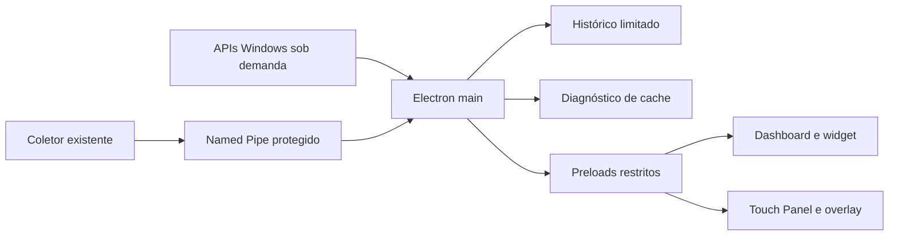

# Windows 2.0.0-dev.8 — candidata da Central Windows

Implementação na branch `feature/windows-control-center`, baseada em `7cf89ac`.
Android está congelado. Nenhuma instalação foi atualizada. Esta entrega é uma
candidata local de desenvolvimento e não significa conclusão de todas as integrações.

## Entrega implementada

| Módulo | Funcional no código | Limite atual |
|---|---|---|
| Central Windows | 12 áreas integradas, mantendo as três abas, widget e bandeja | Execução de comandos operacionais continua ausente |
| Hardware | Inventário Windows sob demanda: CPU/núcleos/clock reportado, módulos RAM, volumes, drivers e periféricos | Novo inventário validado com substitutos e parser; sem nova sessão física |
| Sensores contínuos | Reutiliza coletor e Named Pipe/ADLX aprovados; Touch/overlay compartilham o mesmo host | Nenhuma nova coleta física nesta tarefa; temperatura CPU indisponível |
| Histórico | Opt-in, 5/30/60 min e 6h/24h/7 dias, gráficos e exportação CSV | Máximo 4 MiB/20 mil pontos; retenção efetiva depende do limite, sem interpolação |
| Diagnóstico | Cache local do host como evidência, mantendo adaptadores de demonstração separados | Não consulta agente; autenticação HTTPS/inicialização permanecem Não verificado |
| Manutenção | Prévia limitada de metadados do cache/temporários, estimativas, planos SFC/DISM/rede/Update | Sem exclusão, reparo, varredura de documentos pessoais ou inspeção da Lixeira |
| Gerenciamento | Processos/RAM/CPU acumulada, aplicativos, inicialização, serviços, eventos e drivers | Somente leitura; não equivale ao Gerenciador de Tarefas completo |
| Otimização | Perfis locais Padrão/Equilibrado/Desempenho/Gamer/Personalizado, efeitos e reversão descritos | Salvar perfil não altera Windows, energia ou segurança |
| Aplicativos | Inventário, conjuntos pós-formatação, importação/exportação validada e IDs de catálogo | Sem instalar, atualizar, desinstalar ou afirmar versão desatualizada sem fonte |
| Mouse/teclado | Teste em foco de movimento/cliques/duplo clique/teclas e combinações | Intervalos do navegador não são polling rate ou latência física |
| Áudio | Enumeração sob demanda; nível RMS/pico por toque, consentimento nativo, até 10 s, sem gravação | Não acionado fisicamente; sem bateria/firmware/SPL/transcrição |
| Tela | Monitores/frequência/profundidade informadas pelo Electron; padrões de cor/gradiente/contraste/movimento | Sem alterar resolução, calibrar painel ou medir ghosting |
| Rede | Adaptadores/link/contadores, taxas entre leituras, ping/DNS sob demanda, RTT/jitter/perda | Sem velocidade de internet automática; throughput dedicado ainda pendente |
| Jogos | Cadastro local e detecção limitada de manifestos Steam; perfis locais | Sem executar jogos, atalhos ou alterar seus arquivos |
| Sessões FPS | Importação real de CSV PresentMon, streams separados, métricas e arquivo limitado a 20 resumos/1 MiB | Fonte ao vivo não instalada/ativada; CSV exige coluna MsBetweenPresents |
| Overlay | Janela convencional configurável em tamanho/posição, telemetria compartilhada, fechar normalmente | Sem hooks/injeção; sem FPS ao vivo; tela cheia exclusiva pode ocultá-la |
| Ambiente | Dispositivos/cenas persistidos, conectores catalogados e prévia tipada de ações | HA/RGB/ventoinhas/IR sem backend físico configurado; nenhum atuador habilitado |
| NEX | Conversa em memória, intenções tipadas de navegação e resumo de evidências, sem execução | Regras locais; provedor IA, STT/TTS e histórico persistido ainda não implementados |
| Touch Panel | Janela horizontal coexistente, seleção de monitor/tela cheia, botões grandes e recuperação ao desconectar monitor | Sem modificar disposição das telas; físico touchscreen ainda não homologado |
| Auditoria | Estado próprio validado/atômico, exportação/importação, 120 códigos de ações | Não é backup do Windows; arquivos inválidos são preservados em modo restrito |

## Arquitetura e segurança

Renderers em sandbox, `contextIsolation: true`, `nodeIntegration: false`,
CSP com `connect-src none`, arquivos locais explicitamente permitidos, sem webview
ou navegação externa. Painéis possuem preload próprio e validação de frame exato.
Novas ferramentas usam enumerações, não executáveis/argumentos arbitrários.
Diálogos e requisições têm limites de concorrência/frequência; consultas de
inventário são limitadas/cached. Apenas o helper PowerShell fixo pode executar
consultas sob demanda, sem shell. Seu timeout de 10 s se aplica ao próprio helper,
nunca a um PID recebido. O helper não é iniciado na abertura da Central.

O teste de microfone é solicitado só pelo botão, com decisão local padrão Cancelar.
Somente áudio do frame principal pode receber consentimento; câmera, tela,
subframes, HID/USB e demais permissões continuam negados. O fluxo não grava nem
envia áudio. A semântica dos callbacks é a do
[Electron Session](https://www.electronjs.org/docs/latest/api/session#sessetpermissioncheckhandlerhandler).
ACL por SID e validação do peer no transporte existente não isolam completamente
outros processos maliciosos executados sob a mesma conta. Não se afirma
autenticação criptográfica independente para cada processo local.
Nenhuma chave do Samsung foi copiada. Não existe cliente HTTPS operacional desktop.

Dados nulos, zero válido e dados antigos mantêm estados diferentes. A política
ADLX permanece: ingresso 1,5 s; GPU ativa 3 s, inativa 11 s; retomada aguarda nova
amostra, com indisponibilidade explícita após 10 s. Nenhuma validação foi relaxada.

## Validação e desempenho

- 19 suítes Node: **3.242 verificações**, aprovadas.
- Python: **268 testes**, sem falhas ou skips, com chamadas físicas/rede/Registro
  bloqueadas; somente 22 processos da ponte simulada verificada foram permitidos,
  todos encerrados normalmente.
- C++: **35 verificações** no executável mock; DLL ADLX real não carregada.
- Runtime: 39 arquivos, 527 fontes stdlib; **2.323 verificações** estáticas/importação
  pela instalação Python existente, com sensores/processos/rede bloqueados.
- Revisão Electron real de desenvolvimento: 100%, 125%, 150%, **28 verificações e
  16 capturas por escala**, sem renderer errors; sensores, microfone e ações físicas
  não acionados. Perfis UUID separados. Ver recibos em `evidence/`.

Amostragem do próprio Electron: três intervalos de cerca de 1 s após a navegação,
com compositor de software somente no runner. RSS médio somado: **374,50 / 397,91 /
444,59 MiB** em 100/125/150%; maiores somas observadas: **376,45 / 400,73 / 447,76 MiB**.
Soma média do `percentCPUUsage` da API: **0,0224 / 0,0251 / 0,0357%**, respectivamente.
A primeira leitura da API é descartada. São médias de intervalo da
[CPUUsage](https://www.electronjs.org/docs/latest/api/structures/cpu-usage); a memória
vem de [MemoryInfo](https://www.electronjs.org/docs/latest/api/structures/memory-info),
convertida de KiB para MiB. Páginas compartilhadas podem ser somadas mais de uma vez.
São apenas três intervalos, sem coletor, ADLX real ou jogo: não comparam de forma
válida com as sessões físicas anteriores e não demonstram impacto no CS2.

## Preservação e pendências

Comparação passiva: **117 arquivos instalados** e **78 arquivos de perfil** idênticos
à referência disponível; `debug.log` preservado. Backup `Windows-before-dev7-20261026T152048Z`:
**194 arquivos verificados por SHA-256**, íntegros. Configuração/certificados/arquivos
DPAPI mantêm os hashes. Banco lido com `mode=ro`: quick_check OK, **zero grants** e
zero comandos aceitos/em despacho. Não houve descriptografia de credenciais.

**Agente operacional encontrado offline**, sem supervisor/worker/listener 8776.
Não foi iniciado ou reparado; não houve consulta HTTPS nesta tarefa. Não se pode
confirmar autenticação atual ou conexão do Samsung. PID 11724 não existia no momento
da consulta; nenhuma ação o encerrou nesta sessão. Android não foi acessado,
compilado ou testado. Outros backups não foram revalidados integralmente.

Permanecem abertas: TLS 10054, inicialização automática, encerramento gracioso do
legado, Crashpad, homologação GPU após bandeja/splash Android e sensor térmico CPU.
Os fontes do agente e do monitoramento físico foram preservados. Não se atribui a
indisponibilidade do agente a esta alteração nem à tarefa OneSettings sem evidência.

## Pacotes e atualização futura

Instalador NSIS x64 assistido e portátil são candidatos **NotSigned**, sem
Authenticode. Sem serviços, drivers, tarefas, Run keys ou regra de firewall nova.
`runAfterFinish:false`, instalação por usuário/asInvoker e sem remoção de userData.
Não foram executados instalador, portátil, Python empacotado ou aplicação empacotada.
O build extrai o desinstalador estaticamente; não executa seu gerador.

Runtime/licença ADLX e CPython preservados. Ponte somente leitura, sem headers,
helper/samples SDK ou DLL de driver redistribuídos. A revisão local anterior da
[licença](../windows-dev7/LICENSE-REVIEW.md) continua a referência; não há autorização
nova para distribuir a terceiros. PDF original e avisos seguem no runtime.

Após aprovação específica: verificar novo backup da dev.7/perfil, conferir hash e
assinatura ausente, instalar NSIS assistido sem iniciar ao final e comparar perfil.
A primeira execução deve ser autorizada separadamente: validar inventário sob
comando, sensores, histórico opt-in, Touch/overlay, suspensão, restauração, bandeja
Sair e ausência de órfãos. Reservar encerramento antes do limite da sessão. Microfone,
rede e quaisquer ações físicas precisam de interação explícita; nenhuma é automática.
Recuperação do agente offline é procedimento separado, com autorização específica.

Reversão desta entrega é somente de código: reverter os commits da candidata e
retornar à branch anterior, preservando trabalho concorrente. Nada instalado requer
rollback agora. Numa futura atualização, voltar à dev.7 requer procedimento assistido
aprovado e restaurar somente seus arquivos/perfil após backup, sem limpar dados,
sem downgrade destrutivo e sem tocar no agente. Os diretórios novos `workbench/`
pertencem ao aplicativo e devem ser preservados antes de qualquer migração reversa.

## Evidências visuais

As capturas `../windows-control-center-development/captures/scale-1`, `scale-1_25`
e `scale-1_5` são do Electron de desenvolvimento. Valores Indisponíveis são reais
para a revisão sem coletor; não são medições inventadas. Os arquivos soltos no
nível anterior correspondem à evolução anterior da prévia de desenvolvimento.

## Checkpoints desta entrega

- `2e711ad`: Central Windows, catálogo, serviço local e inventário sob demanda.
- `eaded9d`: histórico ampliado e painéis auxiliares.
- `c688906`: evidências locais, sessões importadas, áudio e inspeção limitada.
- `755f429`: integração, preloads e preparação da candidata dev.8.
- Evidências e documentação ficam no checkpoint documental seguinte.

[Pacotes e hashes](ARTIFACTS.md) · [Capturas por escala](VISUAL-REVIEW.md).
